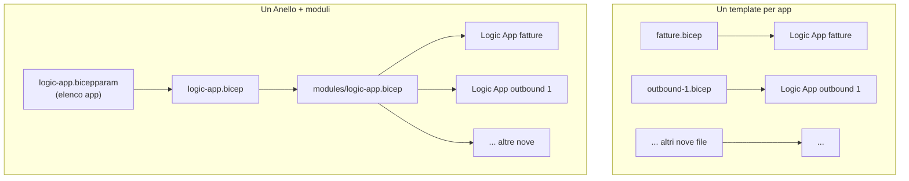

> *Un Anello per domarli, un Anello per trovarli,*
> *un Anello per ghermirli e nel buio incatenarli.*

Tolkien parlava di anelli, ma secondo me avrebbe capito al volo anche il dilemma di chiunque scriva Bicep: **un template per ogni risorsa**, oppure **un template solo** che, a colpi di moduli, le governa tutte? 💍

In questo post racconto un caso reale: undici Logic App Standard governate da un unico template. Parlo anche di quando l'Anello ti salva, di quando ti trasforma in Gollum, e di una modifica che con undici template separati avrei dovuto fare undici volte. ☕

## Il problema

Il progetto è un'integrazione logistica: undici Logic App Standard, una per ogni direzione dei flussi (outbound e inbound verso i vari partner, più alcuni flussi dedicati). Condividono lo stesso piano Workflow Standard e lo stesso storage account per `AzureWebJobsStorage`.

La struttura dell'IaC è questa:

```text
infra/
├── logic-app/
│   ├── logic-app.bicep          # l'Anello: un entry point per tutte le Logic App
│   ├── logic-app.bicepparam     # l'elenco delle undici app
│   └── modules/
│       └── logic-app.bicep      # come è fatta UNA Logic App
├── function-app/                # stesso schema per le Function App
└── shared/modules/              # moduli usati da più famiglie
    ├── union-app-settings.bicep
    └── keyvault-access-policy.bicep
```

Ogni app nel `.bicepparam` era descritta così:

```bicep
param logicApps = [
  {
    name: '<nome-logic-app-1>'
    hostId: '<host-id-1>'
  }
  {
    name: '<nome-logic-app-fatture>'
    hostId: '<host-id-fatture>'
  }
  // ... altre nove
]
```

Solo `name` e `hostId`. Il modulo aveva una sola variabile `appSettings` con le settings di piattaforma (`APP_KIND`, `AzureWebJobsStorage`, `WEBSITE_CONTENTSHARE`, `AzureFunctionsWebHost__hostid`, App Insights e compagnia), **uguale per tutti i siti**.

Poi è arrivata la Logic App delle fatture. I suoi workflow leggono la configurazione con `@appsetting(...)` dentro `parameters.json` e `connections.json`: dodici chiavi tra connessione SFTP, function key e parametri del flusso. Il template non aveva un posto dove metterle.

Ed ecco la tentazione di ogni Hobbit stanco: *"Facciamo un `logic-app-fatture.bicep` a parte, copiamo il modulo e aggiungiamo le settings. Dieci minuti e via."* 🙃

## L'analisi

Prima di cedere alla tentazione, vale la pena mettere a confronto i due approcci.



### Un template per ogni app

| ✅ Pro | ⚠️ Contro |
|---|---|
| Ogni file si legge da solo, senza saltare tra moduli | La logica comune viene **copiata** N volte, e le copie divergono |
| Il *blast radius* è piccolo: un errore rompe una sola app | Un fix (sicurezza, naming, settings) va applicato N volte, e prima o poi uno lo dimentichi |
| Deploy rapidi e mirati sulla singola app | Le regole condivise (per esempio l'host ID ≤ 32 caratteri) restano nella testa di chi le conosce, non nel codice |
| Ownership chiara se app diverse sono di team diversi | Le app "uguali" smettono di esserlo senza che nessuno se ne accorga |

### Un Anello + moduli

| ✅ Pro | ⚠️ Contro |
|---|---|
| **Una sola definizione** di com'è fatta una Logic App: i fix si fanno una volta | Un errore nel modulo colpisce **tutte** le app |
| Aggiungere un'app significa aggiungere una voce al `.bicepparam` | Il deploy tocca tutto, e il `-WhatIf` è più lungo da leggere |
| Le regole condivise diventano codice: decorator, validazioni, guard | Rischio "Sauron": il modulo si gonfia di `if` e flag fino a diventare illeggibile |
| L'elenco delle app è anche la loro documentazione | Ci sono limiti ARM da tenere d'occhio (per esempio 800 risorse per template) |

### Quando l'Anello ti trasforma in Gollum

L'approccio a moduli non è gratis. Il segnale d'allarme è uno solo: **le risorse governate dall'Anello non sono più davvero della stessa specie.** Se ogni app ha bisogno di un ramo `if` diverso, di risorse aggiuntive diverse o di un ciclo di vita diverso (una cambia ogni giorno, un'altra una volta l'anno), stai forzando undici cose diverse dentro un'unica forma.

Ed è qui che la struttura del progetto mostra la sua idea: **non è un Anello per tutto il regno.** C'è un entry point per famiglia (Logic App, Function App, Key Vault…), e i moduli davvero comuni vivono in `shared/modules`. Del resto anche Sauron aveva distribuito altri diciannove anelli. 💍

> La regola che uso: **stessa specie → stesso Anello.** Se due risorse si differenziano solo per *parametri*, vanno nello stesso template. Se si differenziano per *struttura*, meritano un entry point separato, che può comunque riusare i moduli condivisi.
{: .prompt-tip }

### Il caso delle fatture

La Logic App delle fatture è della stessa specie delle altre: stesso piano, stesso storage, stesse settings di piattaforma, stessa identity. Cambia solo **qualche valore di configurazione**, quindi la differenza è di parametri, non di struttura. Niente fork: l'Anello va esteso.

Prima ho preso l'elenco preciso delle chiavi dai file del progetto workflow:

```bash
grep -oh "@appsetting('[^']*')" parameters.json connections.json | sort -u
```

| Famiglia | Esempi | Dove va il valore |
|---|---|---|
| Configurazione del flusso | `InvoicePrefix`, `resourceGroupName`, `subscriptionId`, nome della Function App chiamata | in chiaro nel `.bicepparam` |
| Connessione SFTP | `Sftp_sshHostAddress`, `Sftp_portNumber`, `Sftp_username`, `Sftp_rootDirectory`… | in chiaro nel `.bicepparam` |
| Segreti | `Sftp_password`, `azureFunctionOperation_functionAppKey` | **Key Vault reference**, mai in chiaro |

Poi tre decisioni di design:

1. **Oggetto, non array.** Nel `.bicepparam` un `{ chiave: valore }` si legge molto meglio di una lista di `{ name: ..., value: ... }`.
2. **Opzionale.** Le altre dieci app non devono cambiare di una virgola.
3. **Le settings di piattaforma non si toccano.** Se una setting di una singola app ha lo stesso nome di una di piattaforma, il deploy deve **fallire**. Un `AzureWebJobsStorage` sovrascritto per sbaglio su un'app che condivide lo storage con altre dieci non è un bug che vuoi scoprire in produzione. ⚠️

Il terzo punto è proprio un vantaggio dell'Anello. Con undici template separati, "le settings di piattaforma non si toccano" sarebbe una raccomandazione nel README. Con un modulo unico diventa **una regola nel codice**, valida per tutte.

## La soluzione

### 1. Il `.bicepparam`

Solo l'app che ne ha bisogno riceve il blocco `appSettings`. I segreti sono Key Vault reference:

```bicep
var vaultName = '<nome-key-vault>'

param logicApps = [
  {
    name: '<nome-logic-app-1>'
    hostId: '<host-id-1>'
    // nessuna appSettings: riceve solo quelle di piattaforma
  }
  {
    name: '<nome-logic-app-fatture>'
    hostId: '<host-id-fatture>'
    appSettings: {
      InvoicePrefix: '<prefisso-file>'
      invoiceFunctionAppName: '<nome-function-app>'
      Sftp_sshHostAddress: '<host-sftp>'
      Sftp_portNumber: '22'
      Sftp_username: '<utente-sftp>'
      // ...
      Sftp_password: '@Microsoft.KeyVault(VaultName=${vaultName};SecretName=<nome-secret-password-sftp>)'
      azureFunctionOperation_functionAppKey: '@Microsoft.KeyVault(VaultName=${vaultName};SecretName=<nome-secret-function-key>)'
    }
  }
]
```

Le Key Vault reference non richiedono permessi nuovi: i siti hanno già una system-assigned identity, `keyVaultReferenceIdentity` e un'access policy `get`/`list` sul vault. Anche questa, tra l'altro, è definita **una volta sola** nell'entry point, con una singola chiamata al modulo condiviso per tutte le identity.

### 2. L'entry point

Basta una riga, grazie al safe-access operator:

```bicep
module logicAppSites 'modules/logic-app.bicep' = [for app in logicApps: {
  name: 'la-${app.hostId}'
  params: {
    logicAppName: app.name
    hostId: app.hostId
    additionalAppSettings: app.?appSettings ?? {}
    // ...
  }
}]
```

`app.?appSettings` restituisce `null` se la proprietà non c'è, e `?? {}` lo trasforma in un oggetto vuoto.

### 3. Il modulo, con il guard

La vecchia variabile `appSettings` diventa `platformAppSettings`, e arriva il nuovo parametro:

```bicep
@description('Settings extra per questo sito ({ nome: valore }). Le settings di piattaforma non si possono sovrascrivere.')
param additionalAppSettings object = {}
```

Poi il controllo sulle collisioni:

```bicep
var platformAppSettingNames = map(platformAppSettings, s => toLower(s.name))
var overriddenPlatformSettingNames = filter(
  map(items(additionalAppSettings), item => item.key),
  key => contains(platformAppSettingNames, toLower(key))
)

// Niente assert: accedere a una proprietà che non esiste fa fallire il deploy,
// e il nome della proprietà diventa il messaggio d'errore.
var checkedAdditionalAppSettings = empty(overriddenPlatformSettingNames)
  ? additionalAppSettings
  : { none: true }['additionalAppSettings must not override platform app settings, remove: ${join(overriddenPlatformSettingNames, ', ')}']
```

Sì, è un hack. 🙃 Nella versione di Bicep che uso (0.41) non ho trovato un `assert` stabile, e `@allowed` non può referenziare variabili. Indicizzare un oggetto con una chiave inesistente fa fallire la valutazione ARM, e il messaggio d'errore contiene la chiave. Quindi la chiave **è** il messaggio.

Infine il merge, che passa all'overlay con `union()` del [post sul redeploy che cancella le app settings](/posts/redeploy-cancella-app-settings/):

```bicep
var desiredAppSettings = union(
  toObject(platformAppSettings, s => s.name, s => s.value),
  checkedAdditionalAppSettings
)
```

Anche quell'overlay è un modulo in `shared/modules`, usato sia dalle Logic App sia dalle Function App: un fix scritto una volta e due famiglie protette.

### Verifica

- `bicep build` e `bicep build-params` passano, e nel JSON compilato le settings extra compaiono **solo** sull'app delle fatture.
- `-WhatIf` contro Azure gira senza errori. Una risorsa risulta *unsupported*: l'access policy del Key Vault, le cui proprietà dipendono dai principal ID delle identity. Non ho verificato se lo era anche prima della modifica, quindi non la do né per colpa né per innocente.

## Gli effetti

Sull'approccio:

- ✅ La modifica ha toccato **tre file** (entry point, modulo, `.bicepparam`) invece di creare un dodicesimo template quasi uguale agli altri.
- ✅ La prossima app con settings dedicate non richiede codice: basta un blocco `appSettings` nel `.bicepparam`.
- ✅ Le regole condivise (host ID, settings di piattaforma, overlay delle settings esistenti) sono **codice**, non tradizione orale.
- ⚠️ Il prezzo è il blast radius: un errore nel modulo colpisce undici app. Per questo `-WhatIf` va lanciato **prima** di ogni deploy, non quando ci si ricorda.
- ⚠️ Oggi il deploy le porta dietro tutte. Se servisse aggiornarne una sola, un parametro di filtro sull'elenco sarebbe la mitigazione naturale. Non l'ho implementato: per ora non ce n'è stato bisogno.

Sulla modifica:

- ✅ **Zero segreti** nel `.bicepparam`: password e function key sono Key Vault reference.
- ✅ Le altre dieci app restano **esattamente** come prima.
- ⚠️ Il guard scatta **in fase di deploy**, non di compilazione: `bicep build-params` accetta una collisione senza battere ciglio. Non l'ho ancora visto fallire su un deploy reale, quindi non do per scontato il formato esatto del messaggio.
- ⚠️ Il messaggio d'errore è **criptico** (Azure dirà che una proprietà non esiste). La regola "niente override" va scritta anche nel README.
- ⚠️ Le Key Vault reference vogliono che i secret **esistano davvero** nel vault. Se non ci sono, l'errore arriva a runtime, non al deploy.
- ⚠️ Cercando i valori nel repo è saltata fuori una password SFTP **in chiaro** nel `.bicepparam` di una Function App. Era fuori scope ed è finita nella lista delle cose da sistemare. Ogni refactoring è anche un'ispezione gratis. 🔍

## TL;DR

> Stessa specie → stesso Anello. Se le tue risorse differiscono solo per i parametri, usa **un entry point con un modulo** e un elenco nel `.bicepparam`, non N template copiati. Fix e regole li scrivi una volta, e una nuova risorsa è una riga di configurazione. Il prezzo è il blast radius, e lo paghi con `-WhatIf`. Nel caso reale, dare settings dedicate a una sola Logic App su undici è costato un `appSettings` opzionale, `app.?appSettings ?? {}` e un guard che protegge le settings di piattaforma. Il dodicesimo template copiato non è mai nato. 💍
{: .prompt-tip }
