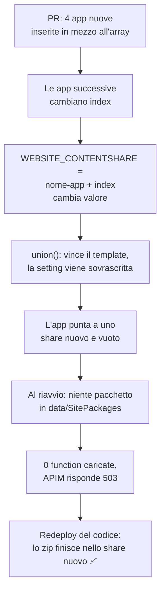

# L'ordine degli addendi cambia il content share

Alle elementari ci hanno insegnato che cambiando l'ordine degli addendi il risultato non cambia. Bicep non era in classe quel giorno. 🙃

Questa è la storia di una PR che aggiungeva quattro Function App a una lista e che, il giorno dopo, ha lasciato a terra una manciata di quelle che **c'erano già**. Nessuno aveva toccato il loro codice o la loro configurazione: si erano solo spostate di qualche posizione in un array.

## Il problema

Il contesto: una ventina di Function App in produzione, su due region, deployate da **un solo template Bicep** che cicla su un array di parametri. Ogni elemento dell'array è un'app: nome, settings, database, metriche. Una pipeline IaC fa il deploy prima su una region e poi sull'altra.

Un giorno arriva la PR che aggiunge quattro app nuove. Le inserisce **in mezzo alla lista**, vicino alle app della stessa famiglia, perché così è più ordinato. Review ok, merge, la pipeline parte.

Poi succede questo:

- nella prima region, **30 secondi** dopo il deploy delle Function, APIM inizia a rispondere `503` su diversi backend;
- nella seconda region i sintomi arrivano **ore dopo**, in piena notte;
- le app colpite smettono di eseguire, ma non c'è un'eccezione o uno stack trace da nessuna parte. L'host è vivo, le function non ci sono;
- ce ne accorgiamo la mattina dopo, circa 21 ore dopo il primo `503`. ☕

E il dettaglio più strano: **ogni app guarisce nel momento esatto in cui qualcuno le rifà il deploy del codice**. Non con un restart, ma con un redeploy.

## L'analisi

### Il pacchetto abita nello share

Le app girano con `WEBSITE_RUN_FROM_PACKAGE=1`. In questa modalità il pacchetto zip del codice viene salvato sotto `data/SitePackages`, nella `/home` dell'app. Su questo piano la `/home` è un **Azure Files share** sullo storage account, e il nome di quello share lo decide l'app setting `WEBSITE_CONTENTSHARE`.

Quindi, se cambi `WEBSITE_CONTENTSHARE`, l'app si ritrova a puntare a uno share **nuovo e vuoto**. Al primo riavvio non trova il pacchetto, carica 0 function e resta lì in silenzio. Un redeploy del codice ricarica lo zip nello share nuovo, e infatti è quello che rimette in piedi l'app.

Restava da capire perché `WEBSITE_CONTENTSHARE` fosse cambiato.

### Il colpevole è `index`

Il modulo della singola Function lo calcolava così:

```bicep
// single-function.bicep
WEBSITE_CONTENTSHARE: '${functionAppName}-${index}'
WEBSITE_RUN_FROM_PACKAGE: '1'
```

E `index` arrivava dal loop del template principale:

```bicep
// main-functions.bicep
module functions 'single-function.bicep' = [for (functionName, index) in functionNames: {
  name: 'fa-${functionName.Name}-${index}'
  params: {
    functionAppName: '<prefisso>-${functionName.Name}-<region>-<env>'
    index: index   // 👈 la posizione nell'array
    // ...
  }
}]
```

Quindi il nome dello share era legato alla **posizione dell'app nella lista**. Le quattro app nuove, inserite in mezzo, hanno spostato in avanti tutte quelle che venivano dopo:

| App | Indice prima | Indice dopo | Share |
|---|---|---|---|
| le prime quattro della lista | 0–3 | 0–3 | invariato ✅ |
| `<app-store>` | 4 | 7 | nuovo, vuoto 💥 |
| `<app-prodotti>` | 8 | 12 | nuovo, vuoto 💥 |
| `<app-stock-1>` | 9 | 13 | nuovo, vuoto 💥 |
| `<app-stock-2>` | 10 | 14 | nuovo, vuoto 💥 |
| `<app-prezzi>` | 13 | 17 | nuovo, vuoto 💥 |

Sullo storage account della seconda region gli share con i suffissi nuovi risultavano creati **proprio durante il run della pipeline**. I numeri della tabella corrispondono esattamente a quello che si ottiene confrontando la lista prima e dopo la PR.

E qui il post sulle [app settings cancellate dal redeploy]() ritorna utile: le settings vengono applicate con `union(attuali, desiderate)`, e se una chiave è nel template **vince il template**. Il `WEBSITE_CONTENTSHARE` nuovo ha quindi sovrascritto quello vecchio senza che nessuno se ne accorgesse.



### Quello che non torna (ancora)

L'onestà prima di tutto: la causa è **sostenuta dai dati, ma non dimostrata al 100%**.

- **Il ritardo nella seconda region.** Scrivere le app settings riavvia l'app subito, e questo spiega i 30 secondi della prima region. Lo stesso riavvio però avrebbe dovuto colpire anche la seconda, e invece i sintomi sono arrivati ore dopo. "Le istanze già avviate vanno avanti finché non vengono riciclate" è un'ipotesi, ma col codice non quadra del tutto. Non lo do per scontato.
- **Lo share vuoto non l'ho visto con i miei occhi.** Non avevo accesso al data plane dello storage. La prova definitiva sarebbe controllare che `data/SitePackages` manchi nello share nuovo e ci sia in quello vecchio.
- **Nello stesso run è uscita un'altra modifica**: lo storage account passava da `Storage` a `StorageV2`. Normalmente l'upgrade non ha downtime e non tocca gli share, quindi è un indiziato debole. Va comunque nominato ed escluso, non ignorato.

Ci sono anche due controlli economici che possono confermare o smontare la teoria:

1. le **prime quattro app**, che non hanno cambiato indice, non dovrebbero avere **nessun** `503` dopo il run. Se ne hanno, la spiegazione è sbagliata o incompleta;
2. negli **ambienti di sviluppo e test** lo stesso spostamento di indici era passato qualche giorno prima. Dove nessuno aveva rifatto il deploy del codice, il sintomo dovrebbe essere lo stesso.

> Quando una diagnosi "torna", la tentazione è smettere di cercare. I punti che non tornano vanno scritti nero su bianco, insieme al test che li chiuderebbe. Altrimenti al prossimo incidente parti da una certezza che non avevi.
{: .prompt-info }

## La soluzione

### La tentazione: togliere l'indice

Il fix più ovvio sembra questo:

```bicep
WEBSITE_CONTENTSHARE: functionAppName   // niente più index
```

Ed è **esattamente lo stesso incidente**, solo più grande: cambia il nome dello share di **tutte** le app in una volta, e tutte puntano a uno share nuovo e vuoto. 💥

> Qualsiasi modifica al calcolo di `WEBSITE_CONTENTSHARE` su app esistenti equivale a spostarle su uno share vuoto. Se proprio devi farla, va accompagnata da un redeploy del codice di tutte le app subito dopo.
{: .prompt-danger }

### Il fix vero: un indice fissato a mano

L'idea è separare il **nome dello share** dalla **posizione nell'array**. Ogni app dichiara il proprio `ContentShareIndex`, inizializzato col valore che usa **oggi**, così il prossimo deploy non sposta niente.

Nei `.bicepparam`:

```bicep
param functionNames = [
  {
    Name: '<app-1>'
    ContentShareIndex: 0
    AppSettings: {}
    // ...
  }
  {
    Name: '<app-2>'
    ContentShareIndex: 1
    AppSettings: {}
    // ...
  }
]
```

Nel template principale l'array diventa **tipizzato**, così il campo è obbligatorio:

```bicep
type functionDefinition = {
  Name: string
  @description('Suffisso fisso di WEBSITE_CONTENTSHARE. Non cambiarlo mai per un\'app esistente.')
  @minValue(0)
  ContentShareIndex: int
  AppSettings: object
  // ...
}

param functionNames functionDefinition[]
```

Se qualcuno aggiunge un'app senza `ContentShareIndex`, la build si ferma prima di toccare Azure:

```text
BCP035: ... missing the following required properties: "ContentShareIndex"
```

C'è poi l'errore opposto: due app con lo stesso indice finirebbero **sullo stesso share**, e sarebbe un incidente diverso ma altrettanto brutto. Quindi aggiungo un controllo sui duplicati:

```bicep
var contentShareIndexes = map(functionNames, f => f.ContentShareIndex)
var duplicatedContentShareIndexes = filter(
  union(contentShareIndexes, []),   // union con [] = valori distinti
  i => length(filter(contentShareIndexes, j => j == i)) > 1
)

module functions 'single-function.bicep' = [for (functionName, index) in functionNames: {
  name: 'fa-${functionName.Name}-${index}'
  params: {
    // ...
    contentShareIndex: empty(duplicatedContentShareIndexes)
      ? functionName.ContentShareIndex
      : fail('Duplicated ContentShareIndex in functionNames: ${string(duplicatedContentShareIndexes)}')
  }
}]
```

E nel modulo della Function:

```bicep
WEBSITE_CONTENTSHARE: '${functionAppName}-${contentShareIndex}'
```

L'`index` del loop rimane, ma solo nei nomi dei deployment ARM, dove non fa danni.

> Il test negativo sul campo mancante l'ho fatto, e la build fallisce come previsto. Il controllo sui duplicati invece usa `fail()` e scatta solo al deploy su Azure, quindi non l'ho ancora visto fallire davvero. Va verificato al primo run in sviluppo.
{: .prompt-warning }

### Prima del merge: what-if

Dato che i valori iniziali li ho dedotti dall'ordine attuale della lista, prima del merge serve un **what-if** su produzione, in tutte e due le region:

```bash
az deployment group what-if \
  --resource-group <nome-rg> \
  --template-file Functions/main-functions.bicep \
  --parameters Functions/Parameters/functions-prd.bicepparam
```

Il risultato atteso è **nessuna modifica a `WEBSITE_CONTENTSHARE`** su nessuna app. Se ne compare una, vuol dire che il valore su Azure è diverso da quello che pensavo (magari qualcuno l'ha sistemato a mano durante l'incidente) e il `ContentShareIndex` di quell'app va allineato al valore reale.

### Le regole per il team

Le tre regole sono semplici:

1. **App nuova**: la metti dove vuoi nella lista e le dai il **primo numero libero** (18, 19, …).
2. **App rimossa**: il suo numero **non si riusa**.
3. **App esistente**: il suo numero **non si cambia mai**.

### Il contorno: perché ce ne siamo accorti dopo 21 ore

Il fix risolve la causa, ma l'incidente ha mostrato anche un buco nel monitoraggio:

- sulle Function **non c'era nessun alert**: il modulo delle metriche c'era, ma tutte le app avevano `MetricSettings: []`;
- l'alert su APIM controllava solo gli eventi verso Event Hub falliti, non gli errori delle richieste;
- lo **Smart Detector** di Application Insights (*Failure Anomalies*) **era scattato** sei minuti dopo il primo `503`, con severità 3. Nessun action group collegato, quindi nessuno l'ha visto. 🙃

La proposta: un alert su APIM che scatta quando un backend ha almeno 10 richieste con almeno il 20% di `5xx` in 5 minuti, per due valutazioni consecutive. Simulato sui log di quei giorni, sarebbe scattato **pochi minuti dopo il deploy**, e nelle 18 ore precedenti non dava falsi positivi. Lo si deploya **a parte**, non con la pipeline delle Function, così per aggiungere un alert non si rischia di toccare di nuovo le app.

## Gli effetti

- ✅ L'**ordine dell'array non conta più**: puoi inserire, spostare e raggruppare le app come vuoi senza cambiare lo share di nessuno.
- ✅ Gli errori diventano **rumorosi e anticipati**: un indice mancante rompe la build, un indice duplicato blocca il deploy prima che parta.
- ✅ Il primo deploy dopo il fix **non sposta niente**, perché gli indici sono inizializzati coi valori attuali (a patto che il what-if lo confermi).
- ⚠️ È una **regola da rispettare**, non una garanzia assoluta: il template impedisce l'indice mancante o duplicato, ma non impedisce a qualcuno di cambiare il numero di un'app esistente. Lo dice la `@description`, lo deve dire anche la review.
- ⚠️ La causa è **molto probabile ma non dimostrata del tutto**: il ritardo nella seconda region resta senza spiegazione, e lo share vuoto non è stato visto direttamente.
- ⚠️ Il fix non tocca il monitoraggio. Senza un alert e un action group, il prossimo problema silenzioso lo scoprirai di nuovo il giorno dopo.

## TL;DR

> Se `WEBSITE_CONTENTSHARE` dipende dall'`index` di un loop Bicep, aggiungere un'app **in mezzo** all'array cambia lo share di tutte quelle dopo. Con `WEBSITE_RUN_FROM_PACKAGE=1` il pacchetto vive in quello share, quindi le app ripartono su uno share vuoto con 0 function finché non rifai il deploy del codice. Fissa un `ContentShareIndex` per app con i valori attuali, rendilo obbligatorio con un tipo, blocca i duplicati con `fail()` e controlla col what-if che non cambi nulla. E collega quel Smart Detector a qualcuno. 🔔
{: .prompt-tip }
